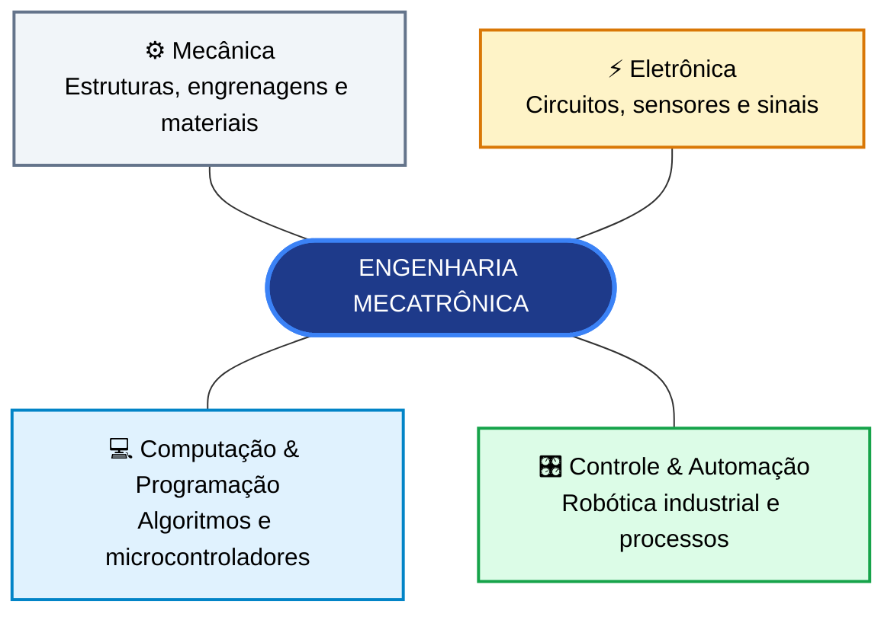

# O que é Engenharia Mecatrônica? 
### Conexões da Oficina com Robótica, Automação e Oportunidades no IFSC

## 📌 1. O que é Engenharia Mecatrônica?

A **Engenharia Mecatrônica** nasceu da necessidade de integrar diferentes áreas do conhecimento para criar sistemas modernos, inteligentes e automatizados. Ela é a fusão sinérgica de quatro grandes pilares:

Em termos simples:
* A **Mecânica** constrói o *corpo* da máquina.
* A **Eletrônica** cria os *nervos* e a transmissão de sinais.
* A **Computação** programa o *cérebro* (lógica e tomada de decisão).
* O **Controle** ensina a máquina a *manter o equilíbrio e a precisão* das suas tarefas.

---

## 🔌 2. O que a Oficina da Air Fryer tem a ver com Mecatrônica e Robótica?

À primeira vista, diagnosticar um circuito de fritadeira elétrica parece apenas manutenção de eletrodomésticos. Porém, **todos os blocos construídos na bancada são os mesmos princípios usados em robôs e linhas automatizadas industriais**:

| O que você fez na Bancada | Onde isso aparece na Mecatrônica e Robótica |
| :--- | :--- |
| **Botão e Resistor** | **Sensores de Fim de Curso e Chaves de Segurança:** Em um braço robótico ou esteira, botões mecânicos e ópticos informam à máquina quando um pistão chegou ao final de curso ou se a porta de segurança foi aberta. |
| **Comando em 12V DC vs Potência em 220V AC** | **Separação de Comando e Força (NR-10 / NR-12):** Nenhuma indústria conecta o cérebro eletrônico do robô diretamente aos motores de alta tensão. Toda automação opera com circuitos lógicos seguros (24V DC / 12V DC) isolados da potência. |
| **Relé de Estado Sólido (SSR com Acoplador Óptico)** | **Módulos de Saída de CLP (Controlador Lógico Programável):** A luz infravermelha acionando a chave é exatamente a forma como computadores de fábrica disparam prensas, caldeiras e soldadores industriais sem sofrer interferência eletromagnética (*ruído*). |
| **Multímetro (Tensão, Continuidade e Resistência)** | **Instrumentação e Diagnóstico de Falhas (*Troubleshooting*):** O engenheiro mecatrônico não "adivinha" problemas; ele levanta hipóteses, analisa diagramas esquemáticos e usa instrumentos para rastrear o sinal elétrico passo a passo. |
| **Controle de Temperatura da Air Fryer** | **Malhas de Controle Térmico:** Sistemas de injeção de plástico, fornos de tratamento de ligas metálicas e impressoras 3D utilizam sensores térmicos (termopares) e acionamento por relés/SSR para manter a temperatura estável. |

---

## 🚀 3. Onde um Engenheiro Mecatrônico atua no Mundo Real?

Por ser uma das engenharias mais versáteis, o profissional de Mecatrônica encontra espaço nos setores mais inovadores da sociedade:

1. **Robótica e Automação Industrial (Indústria 4.0):** Programação de robôs manipuladores (pesquise por braços robóticos KUKA, ABB, Fanuc), esteiras inteligentes e fábricas conectadas à internet (*Industrial IoT*).
2. **Mobilidade Elétrica e Veículos Autônomos:** Projeto de sistemas eletrônicos de tração, gerenciamento de baterias (BMS) e sensores de direção autônoma (LiDAR, radares, visão computacional).
3. **Engenharia Biomédica e Tecnologia em Saúde:** Desenvolvimento de próteses robóticas biomecatrônicas, exoesqueletos de reabilitação e equipamentos de hemodiálise/respiração assistida.
4. **Aeroespacial e Defesa:** Drones, satélites de monitoramento, sondas e sistemas de navegação inercial.
5. **Tecnologia Doméstica e Cidades Inteligentes:** Automação residencial (*Smart Homes*), eletrodomésticos inteligentes, semáforos integrados e eficiência energética predial.

---

## 🏛️ 4. Estude Gratuitamente no IFSC (Câmpus Florianópolis)

O **Instituto Federal de Santa Catarina (IFSC)** é uma instituição pública federal de excelência reconhecida em todo o Brasil. Todos os cursos são **100% gratuitos** (sem mensalidade ou taxa de matrícula), com professores mestres e doutores, projetos de pesquisa com bolsas e laboratórios modernos de ponta.

O Câmpus Florianópolis (localizado na Av. Mauro Ramos, no Centro) oferece uma grande opções de formações para diferentes momentos da vida escolar:

### 🎒 Cursos Técnicos Integrados ao Ensino Médio
*(Para quem está concluindo o Ensino Fundamental / 9º ano — você cursa o Ensino Médio completo junto com a formação técnica profissionalizante):*
* **Técnico Integrado em Eletrônica:** Placas de circuito (PCB), microcontroladores, sensores, telecomunicações e Internet das Coisas (IoT).
* **Técnico Integrado em Eletrotécnica:** Instalações elétricas prediais e industriais, comandos elétricos, redes de distribuição de energia, motores e eficiência energética.
* **Técnico Integrado em Mecatrônica:** Robótica, circuitos eletropneumáticos e eletro-hidráulicos, montagem de mecanismos e programação de microcontroladores.
* **Técnico Integrado em Edificações:** Desenho técnico arquitetônico (prédios e pontes), topografia, materiais de construção civil, projetos complementares e gestão de obras.
* **Técnico Integrado em Saneamento:** Tratamento e análise de água e efluentes, monitoramento ambiental, recursos hídricos, saúde pública e microbiologia ambiental.
* **Técnico Integrado em Química:** Processos químicos industriais, controle de qualidade laboratorial, análises físico-químicas e biotecnologia.

---

### 🎓 Cursos de Graduação 
*(Para quem já concluiu o Ensino Médio, com ingresso via ENEM/SiSU e Vestibular):*
* **Engenharias:**
  * **Bacharelado em Engenharia Mecatrônica:** Robótica, visão computacional, controle de sistemas dinâmicos e automação de processos *(curso com nota máxima no MEC)*.
  * **Bacharelado em Engenharia Eletrônica:** Projeto de circuitos integrados e hardware (PCB), sistemas embarcados, microcontroladores, telecomunicações, processamento de sinais e Internet das Coisas (IoT).
  * **Bacharelado em Engenharia Elétrica:** Sistemas elétricos de potência, geração e transmissão de energia, automação e eletrônica de potência.
  * **Bacharelado em Engenharia Civil:** Estruturas, concreto armado, geotecnia, hidráulica, mobilidade urbana e construções sustentáveis.
* **Bacharelados e Cursos Superiores de Tecnologia:**
  * **Bacharelado em Design (habilitações em Produto e Gráfico):** Modelagem e prototipagem 3D, identidade visual, interfaces digitais (UX/UI) e design estratégico.
  * **Tecnologia em Gestão da Tecnologia da Informação:** Redes de computadores, computação em nuvem, governança de TI, segurança cibernética e gestão ágil de projetos tecnológicos.
  * **Tecnologia em Radiologia:** Diagnóstico médico (Raio-X digital, Tomografia Computadorizada, Ressonância Magnética Nuclear), medicina nuclear e proteção radiológica.
  * **Tecnologia em Sistemas de Energia:** Fontes renováveis (energia solar fotovoltaica e eólica), smart grids, armazenamento em baterias e conservação de energia.

---

### 🔧 Cursos Técnicos Subsequentes
*(Outra opção para quem **já concluiu o Ensino Médio** e quer uma formação profissional de 1,5 a 2 anos focada na entrada no mercado de trabalho):*
* **Técnico em Mecânica:** Desenho assistido por computador (CAD), usinagem convencional e CNC, soldagem industrial, manutenção mecânica e ensaios de materiais.
* **Técnico em Eletrotécnica & Eletrônica:** Automação industrial, comandos de motores, painéis elétricos e manutenção eletrônica.
* **Técnico em Enfermagem:** Cuidado e assistência integral ao paciente em clínicas, ambulatórios, centros cirúrgicos, urgências e hospitais.
* **Técnico em Meteorologia:** Observação atmosférica, estações meteorológicas, previsão de tempo e clima, sensoriamento remoto e monitoramento de eventos extremos *(um dos cursos de maior renome e pioneirismo nacional do IFSC)*.
* **Técnico em Agrimensura / Geoprocessamento:** Topografia computadorizada, cartografia digital, georreferenciamento e mapeamento com drones.
* **Outras formações técnicas:** Edificações, Saneamento, Manutenção Automotiva e Refrigeração (disponibilidade conforme editais semestrais).

---

### 🌐 Como Ingressar no IFSC?
* **Ingresso nos Cursos Técnicos:** Editais semestrais com processos seletivos públicos por exame de classificação ou sorteio público gratuito.
* **Ingresso na Graduação:** Realizado principalmente pelo **SiSU (Sistema de Seleção Unificada, utilizando a nota do ENEM)** e pelo **Vestibular Unificado IFSC/UFSC**.
* **Políticas de Ações Afirmativas (Cotas):** Metade de todas as vagas é reservada para estudantes de escolas públicas, com subdivisões para renda familiar e cotas raciais/indígenas/quilombolas e PcD.
* **Saiba mais nos sites oficiais:**
  * Portal Geral do IFSC: [www.ifsc.edu.br](https://www.ifsc.edu.br/)
  * Câmpus Florianópolis (Av. Mauro Ramos): [florianopolis.ifsc.edu.br](https://florianopolis.ifsc.edu.br/)
  * Guia Completo de Cursos do IFSC: [www.ifsc.edu.br/guia-de-cursos](https://www.ifsc.edu.br/guia-de-cursos)

---

## ✉️ 5. Dúvidas ou Quer Replicar Esta Oficina?

Se você é estudante curioso sobre o curso, professor ou líder comunitário interessado em realizar a oficina *"Entre Fios e Fritas"* em sua escola:

* **Contato da Equipe de Extensão:** Gabrielly — `gabrielly.j02@aluno.ifsc.edu.br`
* **Repositório Aberto no GitHub:** [extensao-engenharia-sociedade](https://github.com/) *(Recurso Educacional Aberto sob licença CC BY-SA 4.0 / MIT)*
