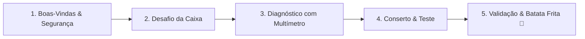

# 🍟 Entre Fios e Fritas: Desvendando a Eletrônica Básica

> **Oficina didática de circuitos elétricos, diagnóstico de falhas e segurança elétrica a partir da manutenção simulada de uma Air Fryer.**

[](https://www.ifsc.edu.br/)
[]()
[]()
[]()
[](LICENSE)

---

## 📌 Sobre o Projeto

O projeto **"Entre Fios e Fritas"** é uma ação de extensão universitária desenvolvida por estudantes da 7ª fase do curso de **Engenharia Mecatrônica do Instituto Federal de Santa Catarina (IFSC - Campus Florianópolis)**, vinculada à disciplina de **Engenharia, Sociedade e Cidadania**.

O propósito central é desmistificar a eletrônica e aproximar estudantes do ensino médio da rede pública das áreas de tecnologia e engenharia. Para isso, utilizamos um eletrodoméstico amplamente presente no dia a dia das famílias brasileiras — a **Air Fryer** — como elemento gerador de curiosidade, investigação e aprendizado prático.

---

## 🎯 Objetivos da Oficina

- **Incentivar Carreiras Tecnológicas:** Despertar vocações para os cursos técnicos e de engenharia através de uma atividade *hands-on* divertida e acolhedora.
- **Ensinar Eletrônica Básica:** Apresentar conceitos essenciais de circuitos elétricos (tensão, corrente, resistência, continuidade e acionamento).
- **Prática Instrumental:** Capacitar os estudantes no manuseio correto e seguro do multímetro digital e na leitura de diagramas esquemáticos.
- **Cidadania e Segurança Elétrica:** Conscientizar sobre os riscos da eletricidade doméstica, prevenção de acidentes, importância de assistência técnica qualificada e autonomia responsável no diagnóstico prévio de defeitos simples.
- **Gamificação e Recompensa:** Proporcionar uma experiência investigativa em equipe, culminando no funcionamento do circuito e em batatas fritas servidas ao final da oficina.

---

## 🛠️ Como Funciona a Dinâmica da Oficina

A oficina foi planejada para uma turma de até **16 alunos**, divididos em **4 equipes de 4 integrantes**, com duração estimada entre **1h30 e 2h00**:



1. **Abertura e Segurança:** Apresentação interativa sobre como uma Air Fryer funciona por dentro e noções fundamentais de segurança elétrica.
2. **Desafio da Caixa Didática:** Cada equipe recebe uma caixa didática que simula a Air Fryer e deve desparafusá-la para acessar o circuito interno.
3. **Diagnóstico Investigativo:** O circuito de cada bancada possui um defeito injetado propositalmente diferente (ex.: resistor aberto, chave desconectada, fusível térmico simulado rompido). Com o esquemático de referência em mãos, os alunos usam o multímetro para encontrar a anomalia.
4. **Reparo e Acionamento:** Com a orientação dos monitores, os alunos realizam o reparo seguro do circuito na protoboard.
5. **Comemoração:** O circuito corrigido aciona os atuadores simulados (ventilação e aquecimento), validando o sucesso da equipe e liberando a porção de batatas fritas.

> [!NOTE]
> **Segurança em Primeiro Lugar:** A bancada opera integralmente em **extra-baixa tensão DC contínua (≤ 12V)**, garantindo risco zero de choque elétrico perigoso para os estudantes participantes.

---

## 📁 Estrutura do Repositório

Este repositório foi concebido como um **Recurso Educacional Aberto (REA)**, permitindo que professores, estudantes e extensionistas de qualquer instituição possam replicar a atividade com facilidade:

```text
extensao-engenharia-sociedade/
├── docs/                                  # Documentações formais e acadêmicas
│   ├── 01-proposta/                       # Proposta oficial da atividade (etapa 1)
│   │   ├── template-projeto-extensao-ifsc.md
│   │   ├── projeto-extensao-curricular-air-fryer.md
│   │   └── acao-extensao-circuitos-basicos.md
│   ├── 02-manual-desenvolvimento/         # Manual conceitual e guia completo de replicação
│   └── 03-apresentacao/                   # Roteiro e slides para apresentação da disciplina
│       ├── roteiro-apresentacao-v2.md
│       └── slides/
│
├── hardware/                              # Projeto elétrico, esquemáticos e mecânica
│   ├── esquematicos/                      # Diagramas oficiais e protótipos em PDF
│   │   ├── esquematico-circuito-oficial.pdf
│   │   └── prototipo-circuitos.pdf
│   ├── explicacao-proposta-circuitos.md   # Justificativa técnica do funcionamento do circuito
│   ├── defeitos-injetados/                # Fichas dos defeitos de cada bancada (guia do instrutor)
│   └── caixa-didatica/                    # Projeto mecânico do gabinete didático
│
├── materiais-didaticos/                   # Materiais impressos e entregues aos alunos
│   ├── manual-do-aluno/                   # Manuais de manutenção e guias práticos
│   │   ├── manual-equipe-manutencao.md
│   │   ├── manual-conserto-air-fryer.html
│   │   └── manual-conserto-versao-estilizada.html
│   ├── guia-multimetro/                   # Guia rápido de uso do multímetro
│   └── seguranca-eletrica/                # Dicas de segurança e conscientização doméstica
│
├── midia/                                 # Registros visuais do projeto
│   └── fotos-execucao/                    # Fotografias da oficina realizada
│
├── .gitignore
├── LICENSE                                # Termos de licença aberta (CC BY-SA 4.0 / MIT)
└── README.md                              # Documento principal de apresentação
```

---

## 🚀 Como Replicar Esta Oficina

Para organizar a oficina em sua escola ou comunidade:

1. **Consulte a Proposta Pedagógica:** Leia os documentos em [`docs/01-proposta/`](docs/01-proposta/) para entender os objetivos e o cronograma.
2. **Monte os Circuitos:** Utilize os diagramas em [`hardware/esquematicos/`](hardware/esquematicos/) e prepare os 4 kits didáticos em protoboard com baixa tensão.
3. **Prepare os Defeitos:** Consulte o guia em [`hardware/defeitos-injetados/`](hardware/defeitos-injetados/) para configurar uma falha diferente para cada grupo.
4. **Imprima os Manuais:** Entregue aos estudantes o material presente em [`materiais-didaticos/manual-do-aluno/`](materiais-didaticos/manual-do-aluno/).
5. **Aplique a Oficina:** Siga o roteiro passo a passo e celebre a aprendizagem!

---

## 👥 Equipe e Instituição

- **Instituição:** Instituto Federal de Educação, Ciência e Tecnologia de Santa Catarina (IFSC) — Campus Florianópolis
- **Curso:** Engenharia Mecatrônica (7ª Fase)
- **Unidade Curricular:** Engenharia, Sociedade e Cidadania

---

## 📜 Licença

Os conteúdos didáticos deste repositório são distribuídos sob a licença [Creative Commons Atribuição-CompartilhaIgual 4.0 Internacional (CC BY-SA 4.0)](LICENSE) e os projetos técnicos sob a [Licença MIT](LICENSE). Sinta-se encorajado a utilizar, adaptar e expandir esta oficina!