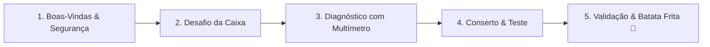

# 🍟 Entre Fios e Fritas: Desvendando a Eletrônica Básica

> **Oficina didática de circuitos elétricos, diagnóstico de falhas e segurança elétrica a partir da manutenção simulada de uma Air Fryer.**

[](https://www.ifsc.edu.br/)
[](https://www.ifsc.edu.br/en/bacharelado/-/visualizar/engenharia-mecatronica/Campus-Florianopolis/86/133/iNqDjzxklp3A)
[]()
[]()
[](LICENSE)

---

## 📌 Sobre o Projeto

O projeto **"Entre Fios e Fritas"** é uma ação de extensão universitária desenvolvida por estudantes da 7ª fase do curso de **Engenharia Mecatrônica do Instituto Federal de Santa Catarina (IFSC - Campus Florianópolis)**, vinculada à disciplina de **Engenharia, Sociedade e Cidadania**.

O propósito central é desmistificar a eletrônica e aproximar estudantes do ensino médio da rede pública das áreas de tecnologia e engenharia. Para isso, utilizamos um eletrodoméstico amplamente presente no dia a dia das famílias brasileiras — a **Air Fryer** — como elemento gerador de curiosidade, investigação e aprendizado prático.

---

## 🎯 Objetivos da Oficina

- **Incentivar Carreiras Tecnológicas:** Despertar vocações para os cursos técnicos e de engenharia através de uma atividade *hands-on* divertida e acolhedora.
- **Ensinar Eletrônica Básica:** Apresentar conceitos essenciais de circuitos elétricos (tensão, corrente, resistência, continuidade e acionamento).
- **Prática Instrumental:** Capacitar os estudantes no manuseio correto e seguro do multímetro digital e na leitura de diagramas esquemáticos.
- **Cidadania e Segurança Elétrica:** Conscientizar sobre os riscos da eletricidade doméstica, prevenção de acidentes, importância de assistência técnica qualificada e autonomia responsável no diagnóstico prévio de defeitos simples.
- **Gamificação e Recompensa:** Proporcionar uma experiência investigativa em equipe, culminando no funcionamento do circuito e em batatas fritas servidas ao final da oficina.

---

## 🛠️ Como Funciona a Dinâmica da Oficina

A oficina foi planejada para uma turma de até **16 alunos**, divididos em **4 equipes de 4 integrantes**, com duração estimada entre **1h30 e 2h00**:



1. **Abertura e Segurança:** Apresentação interativa sobre como uma Air Fryer funciona por dentro e noções fundamentais de segurança elétrica.
2. **Desafio da Caixa Didática:** Cada equipe recebe uma caixa didática que simula o circuito de acionamento da Air Fryer e deve desparafusá-la para acessar o circuito interno.
3. **Diagnóstico Investigativo:** O circuito de cada bancada possui um defeito injetado propositalmente diferente. Com o esquemático de referência em mãos, os alunos usam o multímetro para encontrar a anomalia.
4. **Reparo e Acionamento:** Com a orientação dos monitores, os alunos realizam o reparo seguro do circuito na protoboard.
5. **Comemoração:** O circuito corrigido aciona os atuadores simulados, validando o sucesso da equipe. Após isso, os monitores demonstram o acionamento da Air Fryer pelo circuito corrigido, liberando a porção de batatas fritas.

> [!NOTE]
> **Segurança em Primeiro Lugar:** A bancada opera integralmente em **extra-baixa tensão DC contínua (≤ 12V)**, garantindo risco zero de choque elétrico perigoso para os estudantes participantes.

---

## 📁 Estrutura do Repositório

Este repositório foi concebido como um **Recurso Educacional Aberto (REA)**, permitindo que professores, estudantes e extensionistas de qualquer instituição possam replicar a atividade com facilidade:

```text
extensao-engenharia-sociedade/
├── 01-proposta/                                  # Proposta oficial e templates da atividade (etapa 1)
│   ├── projeto-extensao-curricular-air-fryer.docx
│   ├── projeto-extensao-curricular-air-fryer.md
│   ├── template-projeto-extensao-ifsc.docx
│   └── template-projeto-extensao-ifsc.md
│
├── 02-manual-desenvolvimento/                    # Guia de replicação, engenharia da bancada e materiais didáticos
│   ├── hardware/                                 # Projeto elétrico, esquemáticos e engenharia da bancada
│   │   ├── esquematicos/                         # Diagramas e esquemáticos elétricos
│   │   │   ├── esquematico-circuito.pdf          # Esquemático elétrico
│   │   │   ├── circuito-tinkercad.png            # Prototipagem visual no Tinkercad
│   │   │   └── diagrama-funcionamento.png        # Diagrama de funcionamento do sistema
│   │   ├── README.md                             # Visão geral do módulo de hardware
│   │   ├── explicacao-proposta-circuitos.docx
│   │   └── explicacao-proposta-circuitos.md      # Guia de Engenharia da Bancada, dimensionamento e injeção de falhas
│   ├── materiais-didaticos/                      # Materiais impressos e entregues aos alunos
│   │   └── manual-do-aluno/                      # Manuais de manutenção e guias práticos da equipe
│   │       ├── manual-equipe-manutencao.md    
│   │       ├── manual-conserto-air-fryer.html    # Manual didático para navegador
│   │       └── manual-conserto-air-fryer.pdf     # Manual em PDF para impressão direta
│   ├── roteiro-apresentacao.md                   # Roteiro cronológico passo a passo da oficina
│   └── guia-carreira-mecatronica-ifsc.md         # Guia de vocação e oportunidades em Mecatrônica no IFSC
│
├── 03-apresentacao/                              # Apresentações interativas em HTML e PDF
│   ├── README.md                                 # Painel do instrutor e guia de uso das apresentações
│   ├── apresentacao-alunos-fios-e-fritas.html    # Versão prática para os estudantes
│   ├── apresentacao-atualizada-com-manual.html   # Versão acadêmica com o manual didático
│   ├── apresentacao-atualizada-com-manual.pdf    # Versão acadêmica em PDF para envio/impressão
│   └── apresentacao-entre-fios-e-fritas.html   
│
├── midia/                                        # Identidade visual, diagramas e ícones
│   ├── icons/                                    # Ícones dos componentes e instrumentos
│   └── images/                                   # Diagrama do circuito e logo institucional
│
├── .gitignore
├── LICENSE                                       # Termos de licença aberta (CC BY-SA 4.0 / MIT)
└── README.md                                     # Documento principal de apresentação
```

---

## 🚀 Como Replicar Esta Oficina

Para organizar a oficina em sua escola ou comunidade:

1. **Consulte a Proposta Pedagógica:** Leia os documentos em [`01-proposta/`](01-proposta/) para entender os objetivos pedagógicos, fundamentação e o cronograma.
2. **Estude o Guia de Engenharia e Monte os Circuitos:** Consulte o [`02-manual-desenvolvimento/hardware/explicacao-proposta-circuitos.md`](02-manual-desenvolvimento/hardware/explicacao-proposta-circuitos.md) para entender a arquitetura de segurança (*Safety by Design*: 12V SELV vs 220V confinado), o dimensionamento da malha de comando e os diagramas em [`02-manual-desenvolvimento/hardware/esquematicos/`](02-manual-desenvolvimento/hardware/esquematicos/).
3. **Configure as 4 Bancadas com Falhas Controladas:** Siga o passo a passo da Seção 4 do [`02-manual-desenvolvimento/hardware/explicacao-proposta-circuitos.md`](02-manual-desenvolvimento/hardware/explicacao-proposta-circuitos.md) para injetar as falhas em cada protoboard (LED invertido, jumper deslocado, resistor de 100kΩ e botão rotacionado em 90°).
4. **Imprima os Manuais dos Estudantes:** Entregue a cada equipe o manual de diagnóstico disponível em [`02-manual-desenvolvimento/materiais-didaticos/manual-do-aluno/manual-conserto-air-fryer.pdf`](02-manual-desenvolvimento/materiais-didaticos/manual-do-aluno/manual-conserto-air-fryer.pdf).
5. **Apresente e Conduza a Oficina:** Utilize a apresentação interativa [`03-apresentacao/apresentacao-atualizada-com-manual.html`](03-apresentacao/apresentacao-atualizada-com-manual.html) (ou a versão lúdica dos alunos [`apresentacao-alunos-fios-e-fritas.html`](03-apresentacao/apresentacao-alunos-fios-e-fritas.html)), acompanhe o roteiro e finalize com as batatas fritas servidas para as equipes!

---

## 👥 Equipe e Instituição

- **Instituição:** Instituto Federal de Educação, Ciência e Tecnologia de Santa Catarina (IFSC) — Campus Florianópolis
- **Curso:** Engenharia Mecatrônica (7ª Fase)
- **Unidade Curricular:** Engenharia, Sociedade e Cidadania
- **Orientadora:** Profª. Marcia Eunice Lobo
- **Alunos participantes:**
    - Enzo Renan Moreira Tralli
    - Flavia Amaral das Neves
    - Gabrielly Jacobsen Oliveira
    - Luís Fernando Rosset
    - Thauan Felipe Silva Feitoza

---

## 📜 Licença

Os conteúdos didáticos deste repositório são distribuídos sob a licença [Creative Commons Atribuição-CompartilhaIgual 4.0 Internacional (CC BY-SA 4.0)](LICENSE) e os projetos técnicos sob a [Licença MIT](LICENSE). Sinta-se encorajado a utilizar, adaptar e expandir esta oficina!
